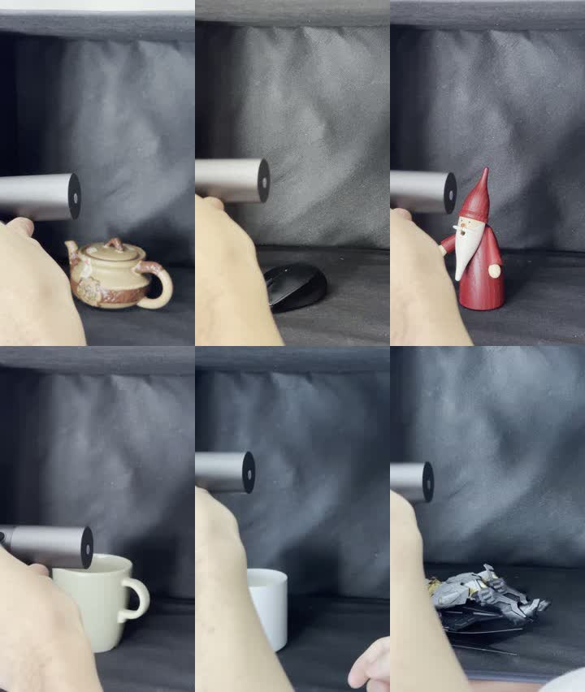
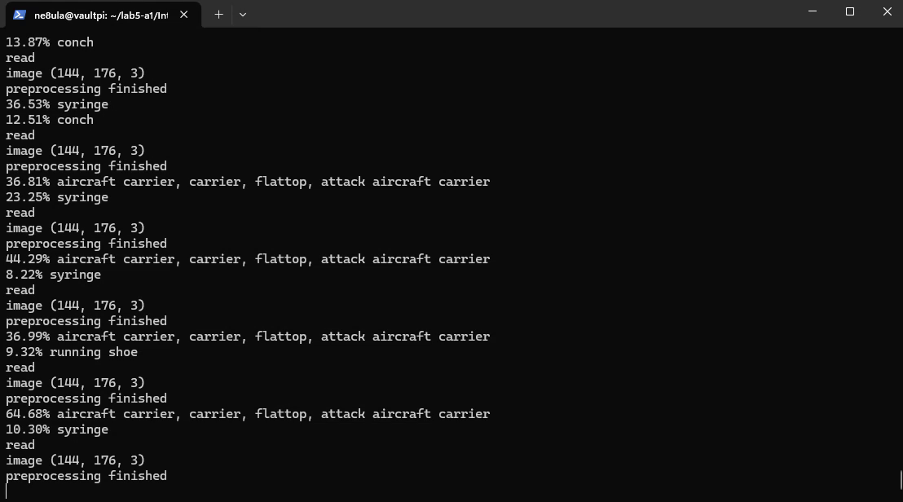
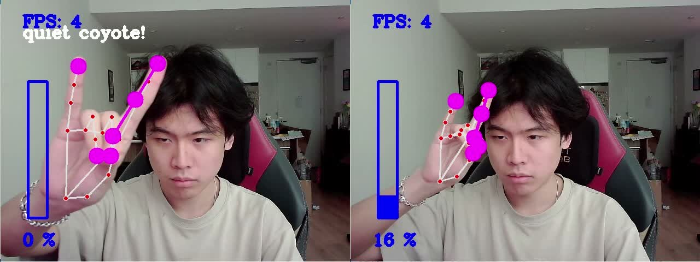
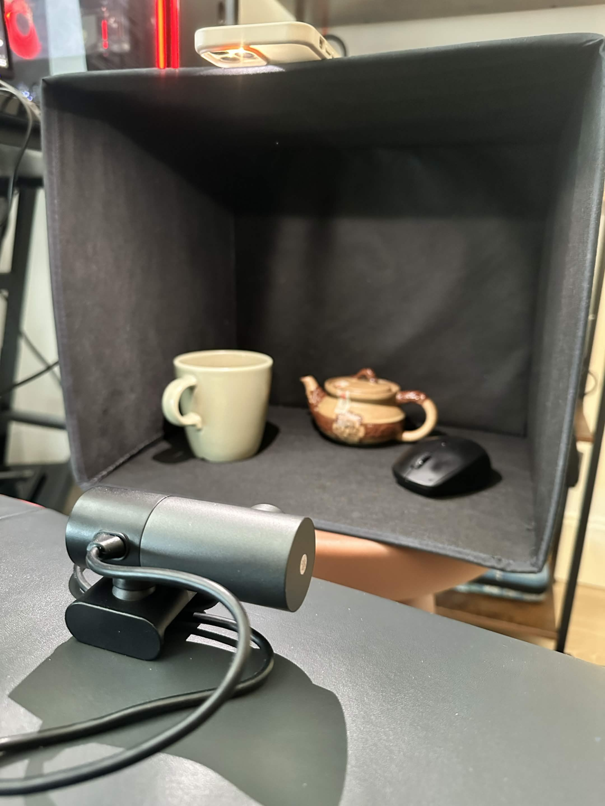
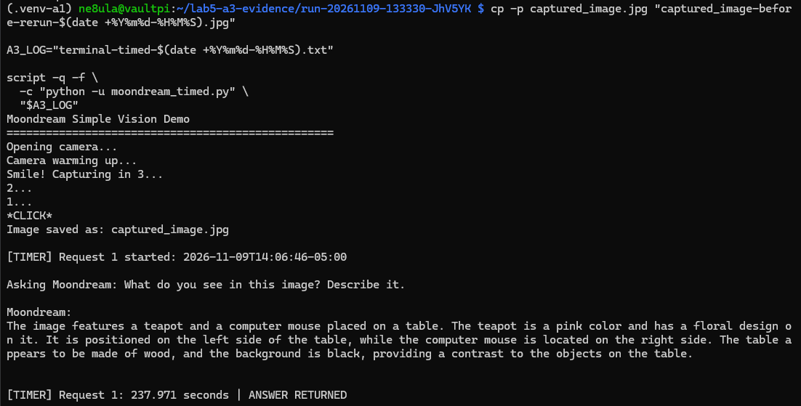
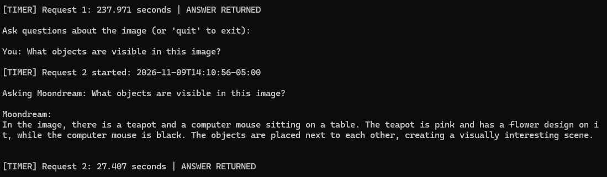
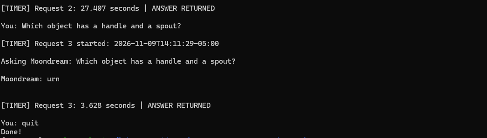

# Shelf Watcher — Lab 5: Observant Systems

**Author:** Hao Chen Xiong

**Collaborators:** None

**Deadline:** None specified

**Status:** I've completed and documented A1 (PyTorch), A2 (MediaPipe), and A3 (Moondream). The remaining sections are still in progress; I haven't demonstrated the integrated Shelf Watcher yet.

Shelf Watcher is a small robot mascot placed on a shelf beside a work desk. A USB webcam observes the physical monitor, and a custom image classifier recognizes selected work, video, and neutral screen appearances. Sustained video detection is intended to trigger a spoken reminder and a suspicious expression on a miniPiTFT face. Break and work-video overrides give the user control over interruptions.

**Scope:** optical camera capture only; no screen sharing, screenshot API, browser history, or application telemetry. A screen appearance is not proof that the user is unproductive. A tutorial can be work; a static page can be distracting.

This document separates the completed A1–A3 experiments from design rationale and explicitly labeled **planned**, **hypothesized**, and **PENDING** work. These experiments do not establish performance of the proposed WORK/VIDEO/NEUTRAL classifier or integrated robot.

## Navigation

- [Requirement-by-requirement checklist](docs/deliverables.md)
- [Build sequence and setup](docs/build-plan.md)
- [Hardware, cables, and tools](docs/materials.md)
- [Test protocol](docs/test-plan.md) and [trial sheet](experiments/trials.csv)
- [Experiment notebook](experiments/notebook.md)
- [Evidence index and recording plan](evidence/README.md)
- [Source references](docs/sources.md)

## Preparation

The target is a Raspberry Pi 4, USB webcam, speaker, and Adafruit miniPiTFT labeled 240×135. A1 ran on the Pi with a course-provided USB webcam; its model is unknown. The earlier inventory listed an EH-1080P6, but that identity is not confirmed for the A1 recording. The reported environment is Debian 12 (Bookworm), aarch64 / 64-bit, Python 3.11.2, PyTorch 2.9.0+cpu, TorchVision 0.24.0, and OpenCV 4.11.0. USB camera capture was verified for A1; speaker and display operation remain PENDING.

The robot will use a simple rounded box body, integrated feet, a removable back, a screen face, and an independently aimable chest camera. Initial construction leaves the Pi and speaker behind the mascot. The exact display connector clearance and all enclosure dimensions must be measured before CAD or printing. The servo and spare OLED are excluded from the first build.

| Preparation task | Status / evidence |
|---|---|
| Obtain Fall2025 starter files | Retrieved on Pi; unchanged `infer.py` used for A1, per author confirmation |
| Establish VNC desktop access | PENDING |
| Install and record dependency versions | A1 versions reported above; other demo environments remain PENDING |
| Verify camera, speaker, and display | A1 USB camera verified; speaker and display remain PENDING |
| Read OpenCV, PyTorch, MediaPipe, and Teachable Machine introductions | PENDING author reading |
| Read Bellotti et al., *Making Sense of Sensing Systems* | PENDING author reading; source linked below |

After reading the paper, relate its five questions to the actual interface: how to address the device, recognize its attention, understand available actions, interpret its response, and recover from errors. Record the author's interpretation in the notebook; this prompt is not a completed reading reflection.

## Part A

### A1. PyTorch / MobileNet

**Experiment:** I ran the course's unchanged `infer.py` on a Raspberry Pi 4, viewed its output through SSH, and held the USB webcam toward six objects in sequence: a small ceramic teapot, a computer mouse, a simple wooden Santa figure, a mug, a candle in a white container, and a complex Gundam/Batman figure. 

**Configuration and code:** I used the provided infer.py script without changing it. It uses MobileNet v2 to classify the webcam image and prints its top two predictions for each frame.

All **425 frames** in the saved log have shape `(144, 176, 3)`: the camera actually supplied **176 × 144 pixels**, not the requested square resolution. The first two FPS reports were **0.67** and **2.75**; the remaining 52 reports ranged from **6.03–7.40 FPS**, with a median of **7.24 FPS**. These are the script's periodic processing-loop throughput readings, including capture, preprocessing, inference, and printing. They are not the camera's hardware FPS or an isolated inference benchmark.

| Object / observation | Result and interpretation |
|---|---|
| Ceramic teapot | The early sequence produced `teapot`, including a 94.59% top score; alternatives included `coffeepot` and `cup`. |
| Computer mouse |The following sequence produced `mouse, computer mouse`, reaching a 99.88% top score. This was a clear example of a familiar category being recognized. |
| Wooden Santa |Predictions were unstable and did not identify Santa; the corresponding part of the log includes `lipstick` and `Christmas stocking`.  |
| Mug |The mug sequence included `cup` and `coffee mug`. Their highest top scores in the run were 89.28% and 64.36%, respectively. |
| Candle in a white container |A `candle` label appeared briefly in the log, but the object was mistaken as cups, and many other random items. |
| Gundam/Batman figure | The figure sequence produced unrelated labels including `aircraft carrier` and `syringe`; the terminal still below shows a 64.68% `aircraft carrier` score. |

Note: Object transitions, hands, and the background (although I ensured the background was as unobstrusive as possible), were also part of the captured scene,

**What failed and why:** Both the simple Santa and the complex figure were misclassified. This demonstrates a limitation of the recognition system. The supplied [class list](https://github.com/IRL-CT/Interactive-Lab-Hub/blob/9ef02d4ead28bafc0a803116a6a952f3908b7463/Lab%205/classes.json) has no Santa, Gundam, or Batman, or anything related for its category, so the model cannot directly output those identities. A candle container can resemble a cup because of varying viewpoint and low captured resolution are plausible additional contributors, but this experiment did not isolate their effects. Frame-by-frame classification explains why the displayed labels can switch rapidly.

**Evidence:** [Object demonstration (51 s)](evidence/a1/objects.mp4) · [Terminal recording (63 s)](evidence/a1/terminal.mp4) · [Text log](evidence/a1/a1-final-20261109-122444-WnQoJV.txt) · 

Phone-video stills at 00:01, 00:07, 00:14, 00:21, 00:30, and 00:44

### A2. MediaPipe

I ran `hand_pose.py` on the Pi and tested hand tracking, pinch control, Quiet Coyote, and recovery. The dots followed my fingers, and opening or closing the gap between my thumb and index finger changed the percentage and audio volume.

I also moved my hand toward and away from the camera while trying to keep the same finger gap. The volume still changed: the display went from **14% at 0:45 to 91% at 0:49**. The script measures the gap in image pixels, so moving closer makes it look bigger; it doesn't account for depth.

Quiet Coyote silenced the audio and showed **0% at 1:00**. When I rotated my hand sideways, the dots overlapped and the gesture stopped registering, even though my hand was still tracked. By **1:05**, the display showed **18%** and the audio had resumed. Rotation changes the distances the gesture rule checks. I then returned to pinch control and could adjust the volume again.

For the prototype in future parts,, I could use a gesture to pause reminders and a pinch to set the pause length. After this test, I'd keep the pause active until a clear resume action, so turning my hand wouldn't accidentally restart reminders.

**Evidence:** [Full demo with audio (1:49)](evidence/a2/hand-tracking.mp4) · [Video timestamps and file details](evidence/a2/README.md).

*Left: Quiet Coyote recognized. Right: recognition drops during rotation, while hand tracking continues.*

### A3. Moondream

I ran Moondream through Ollama on the Pi in CPU-only mode, using `moondream_simple.py` with a separate timing wrapper. I arranged a mug, a ceramic teapot, and a computer mouse in front of the webcam against a dark background. The script captured one image, then used that same image for all three questions.

The first question, **“What do you see in this image? Describe it.”**, took **237.971 seconds**, almost four minutes. Moondream identified a teapot and a computer mouse, described the teapot as pink with a floral design, and said they were on a wooden table. When I asked **“What objects are visible in this image?”**, it again named the teapot and mouse and took **27.407 seconds**. Neither answer mentioned the mug visible in my setup photo. The pink teapot and wooden surface descriptions also don't match that photo, although the photo shows the setup from a different viewpoint than the webcam.

I then asked **“Which object has a handle and a spout?”** It answered **“urn”** in **3.628 seconds**. This was the wrong identification for my teapot, even though the earlier descriptions called it a teapot. The script sends each question independently, so it doesn't carry the earlier answers into the next request. The answers were inconsistent across questions; I didn't isolate why.

These are times from sending each request through printing its completed answer, including image encoding, but excluding camera capture and my typing. This was a rerun with different questions and answer lengths, so the timing difference doesn't establish how much time model loading took.

For Shelf Watcher, a response arriving almost four minutes after capture could describe a scene that has already changed. I'd use this kind of description for an occasional desk summary, with a visible processing state and capture time. For timely reminders, I'd continue testing the smaller custom classifier planned for the next part. The quick but incorrect “urn” answer also shows why speed alone isn't enough to judge whether the response is useful.

**Evidence:** [Exact questions, answers, timings, and file details](evidence/a3/README.md). My setup photo and all three terminal screenshots are shown below.

*My physical setup. This is an external photo, not the webcam's captured input image.*

*Request 1: the initial description takes almost four minutes.*

*Request 2: the object list again leaves out the mug visible in the setup photo.*

*Request 3: a faster answer, but the wrong identification for the teapot.*

### A4. Teachable Machine

**Planned exploration:** Run the stock `tml_example.py`, then train an Image Project / Standard model for the final camera view. Collect about 200 varied optical images per class (the assignment suggests over 150). Preview, iterate, export TensorFlow Lite and labels, and deploy to the Pi.

| Class | Planned training examples | Collected / held out |
|---|---|---|
| WORK | Actual editor, documents, spreadsheets, and work browsing | PENDING / PENDING |
| VIDEO | Different videos, player layouts, window sizes, and content | PENDING / PENDING |
| NEUTRAL | Blank monitor, desktop, and specific neutral scenes | PENDING / PENDING |

Training and inference must use the same fixed monitor crop and image preprocessing. Hold out a separate capture session and unseen content for testing; neighboring frames from the same recording are not independent validation. NEUTRAL is a trained category, not a guarantee of detecting every unknown image. Low-confidence output gets a separate uncertain behavior.

**Affordances comparison (design analysis):** Teachable Machine lets the designer define categories through examples, at the cost of collecting representative data. MediaPipe exposes landmarks suited to geometric gesture rules and continuous controls. OpenCV provides capture and image-processing primitives from which a designer can build explicit visual rules. These approaches can be combined: Shelf Watcher proposes OpenCV capture/cropping plus a learned classifier.

**PENDING:** stock-model observation; training counts; preview mistakes; changes between model versions; export details; Pi inference outcome; training/preview/export screenshots (A-TM).

## Part B — Fold: construct an interaction

### Proposed interaction

The familiar's face points toward the user while the camera bracket points toward the monitor. The bracket is locked before dataset capture. The model classifies camera frames, and a time-based controller decides when to remind the user. Speech is a prerecorded local line: **“Hey. Back to work.”** No generative speech service is needed.

| Input / condition | Planned output |
|---|---|
| Confident WORK | Relaxed face; clear pending video timer |
| Confident VIDEO | Suspicious face; begin/continue persistence timer |
| VIDEO persists 15 seconds and cooldown permits | Play one reminder; annoyed face; start cooldown |
| NEUTRAL or low-confidence / unstable prediction | Neutral/puzzled face; clear pending video timer; no reminder |
| Missing/stale frame or camera read failure | Camera-error state; clear pending timer; no reminder |
| Break button | Pause reminders for five minutes; show break status |
| Work-video button | Toggle visible work-video override until user clears it |

Starting parameters, not calibrated results: one inference/second, minimum top score 0.85, persistence 15 seconds, cooldown 60 seconds, and break duration 300 seconds. See [configuration proposal](config/settings.example.json). Use elapsed monotonic time rather than assuming a frame rate. Reset pending detection across non-video states, overrides, and capture gaps. Avoid overlapping audio and repeated triggers within the cooldown.

### Planned input/output experiments

1. Compare full camera frame versus fixed monitor crop on the same held-out scenes.
2. Compare immediate triggering versus a 15-second persistence rule.
3. Compare face-only feedback versus face plus speech.
4. Exercise break and work-video overrides with actual video viewing.

**PENDING:** implemented code, measured comparison, selected final settings, setup photograph, and integrated-system video (B-SYSTEM). The table above is a specification, not current executable behavior.

## Part C — Flight test

Use the [test protocol](docs/test-plan.md) and [trial sheet](experiments/trials.csv). The following are hypotheses and intended mitigations, not observations.

| Required question | Design-stage answer / remaining evidence |
|---|---|
| When does it work? | Hypothesis: stable camera, clear monitor view, and familiar layouts represented in training. PENDING measured successes. |
| When does it fail? | Candidate cases: unseen layouts, split screens, glare, occlusion, camera movement, and work videos. PENDING observed failures. |
| Why does it fail? | Possible causes: dataset gaps, small screen details after resizing, background shortcuts, or category ambiguity. Verify using captured examples. |
| Other scenarios that could cause problems? | A paused video, animated work content, a second monitor, another person blocking the camera, theme changes, and display sleep. |
| Are users aware of uncertainty? | Plan: puzzled/error expressions and visible override state; numerical scores in the diagnostic preview. PENDING user reaction. |
| Consequences of misclassification? | False reminders interrupt legitimate work; missed detections reduce usefulness. A score does not establish intent or productivity. |
| How could the interaction address errors? | Persistence, cooldown, manual overrides, camera-error suppression, and easy repositioning. PENDING verification of each implemented behavior. |
| Algorithm optimizations to try? | Fixed crop, representative examples, lower sampling rate, threshold tuning, and retraining. Compare one change on held-out scenes and report the tradeoff. |

**Results summary:** PENDING. Report correct/incorrect/uncertain counts, false reminders during work, missed reminders during video, and end-to-end delay. Keep classifier performance separate from controller correctness. Do not count a work tutorial as leisure ground truth merely because it is a video.

## Part D — Reflect: characterize the system

| Question | Initial characterization to test |
|---|---|
| What can it be used for? | A voluntary personal reminder for familiar screen-viewing habits. It is not a productivity measurement or employee-monitoring tool. |
| Good environment? | Stable shelf mount, clear view of one monitor, and lighting/layouts represented in training. |
| Bad environment? | Strong glare, steep angle, frequent monitor movement, rapidly changing applications, or mixed work/video layouts. |
| When will it break? | Hypothesis: out-of-distribution scenes, obstructed lens, camera disconnect, or changes to crop/mount. Actual cases PENDING. |
| How will it break? | It may confidently choose a wrong class, switch labels, miss a video, or fail to capture. Intended control behavior suppresses alerts on known uncertainty/errors but cannot catch all confident mistakes. |
| Other properties/behaviors? | There is a deliberate 15-second grace period plus inference/playback latency. It needs installation-specific data and manual intent overrides. |
| How does it feel? | Design intent: amusing and gently corrective. Actual author/user experience, including annoyance, is PENDING. |

**Required characterization video:** PENDING — D-CHAR. Demonstrate and narrate the questions above using real successes, faults, and recovery.

## Part 2 — Finished system in use

**Status: NOT BUILT / NOT DEMONSTRATED.**

Planned final sequence: show shelf installation and optical camera view; work normally; switch to a video; wait for the real grace period; hear the reminder; return to work; demonstrate a legitimate tutorial override; show a failure and recovery. Label any edited time compression. Do not imply a prerecorded face sequence is live classification.

- Final integrated demo link: PENDING — FINAL-DEMO.
- Finished enclosure photo: PENDING — FINAL-PHOTO.
- Final code / model / settings revision: PENDING.
- Reproducible final launch command: PENDING implementation and Pi verification.
- Final limitations and improvements: PENDING tests; retain known camera-view and intent limitations.

## References and attribution

- [Official Lab 5, Fall2025](https://github.com/IRL-CT/Interactive-Lab-Hub/tree/Fall2025/Lab%205)
- [Pinned assignment](https://github.com/IRL-CT/Interactive-Lab-Hub/blob/9ef02d4ead28bafc0a803116a6a952f3908b7463/Lab%205/README.md)
- [Bellotti et al. paper](https://sites.cc.gatech.edu/people/home/keith/pubs/chi2002-sensing.pdf)
- [Detailed source and hardware references](docs/sources.md)

This repository is a standalone private student project, not an upstream fork. Original course code is retrieved separately with provenance. Documentation scaffolding and design organization were assisted by Codex; experimental observations must be supplied and reviewed by the author. Course-specific disclosure and submission rules remain to be checked by the author.
