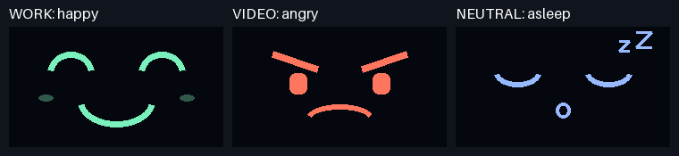

# Experiment 3: mini PiTFT faces and spoken reminders

For the confirmed **Adafruit 1.14-inch mini PiTFT, 135x240, on Raspberry Pi 4**.
The physical face test and experiment 3 are complete: [evidence](../evidence/b1/README.md).
This uses Adafruit's Python/SPI display method.

| Camera classification | Display |
|---|---|
| WORK | Happy |
| VIDEO | Angry |
| NEUTRAL | Asleep |

Faces update when a confident prediction changes. Below 85% or on a stale
prediction, a puzzled face appears. Spoken reminders retain the tested
15-second VIDEO trigger and 15-second cooldown.



## 1. Transfer from Windows PowerShell

```powershell
# Run from the repository root.
Compress-Archive -Path scripts,models,assets -DestinationPath "$env:TEMP\shelf-watcher-pi.zip" -Force
scp "$env:TEMP\shelf-watcher-pi.zip" ne8ula@vaultpi.local:~/part-b-pi.zip
```

## 2. Prepare the Pi, then shut it down

Stop any running camera test with Ctrl+C. In Pi SSH:

```bash
cd ~/a4-shelf-watcher
source ~/venv-tml/bin/activate
python -m zipfile -e ~/part-b-pi.zip .
sudo apt-get update
sudo apt-get install -y libgpiod-dev python3-libgpiod
python -m pip install adafruit-blinka adafruit-circuitpython-rgb-display Pillow RPi.GPIO
sudo raspi-config nonint do_spi 0
sudo shutdown -h now
```

Setup references: [Adafruit Python display setup](https://learn.adafruit.com/adafruit-mini-pitft-135x240-color-tft-add-on-for-raspberry-pi/python-setup)
and [Blinka installation](https://learn.adafruit.com/circuitpython-on-raspberrypi-linux/installing-circuitpython-on-raspberry-pi).
If you previously installed a PiTFT console/kernel driver, follow Adafruit's
instructions to remove its conflicting configuration before using this Python method.

## 3. Attach the display while power is disconnected

After shutdown, unplug Pi power. Fit the display's 2x12 socket onto **physical
pins 1-24**, at the pin-1/3.3V end of the Pi's 40-pin header. All 24 socket holes
must align; the remaining 16 Pi pins stay uncovered. Match the board orientation
to [Adafruit's attachment photo](https://learn.adafruit.com/adafruit-mini-pitft-135x240-color-tft-add-on-for-raspberry-pi/python-setup#attaching).
Do not attach or reposition it while powered. Reconnect power and SSH afterward.

The display uses SPI CE0 and GPIO25, with GPIO22 for its backlight.
[Official pinout](https://learn.adafruit.com/adafruit-mini-pitft-135x240-color-tft-add-on-for-raspberry-pi/pinouts).

## 4. Test the screen

```bash
cd ~/a4-shelf-watcher
source ~/venv-tml/bin/activate
ls -l /dev/spidev0.0
python scripts/b1_display.py --test
```

It should show happy, angry, and asleep for three seconds each, then turn the
backlight off. If upside down, rerun with `--rotation 270` and add
`--display-rotation 270` to the experiment command below. If the test fails,
check the terminal error and SPI configuration before continuing. A successful command alone
does not confirm that the screen looks right.

The tested setup required enabling SPI and releasing Linux's CE0/CE1 claims
using [Adafruit's chip-enable fix](https://learn.adafruit.com/circuitpython-on-raspberrypi-linux/spi-sensors-devices#reassigning-or-disabling-the-spi-chip-enable-lines-3097985), then rebooting.
The experiment runs over SSH; VNC is not needed.

## 5. Run the experiment

Reconnect the Leviathan V2 after reboot if necessary. Check playback, then run:

```bash
python scripts/b1_shelf_watcher.py --mode voice --audio-test
python scripts/b1_shelf_watcher.py --mode voice --display mini-pitft --persistence 15 --cooldown 15 --seconds 180
```

After the ten-second countdown, show WORK, VIDEO, and NEUTRAL scenes. Film the
miniTFT and the monitored screen with your phone, keeping its microphone on.
Keep the Pi camera aimed at the monitor. Compare whether the faces make the
system's current interpretation clearer than voice alone.

The run saves the camera MP4, predictions, metadata, and audio/display events in
`runs/part-b/`. The CSV includes `display_face`; `events.jsonl` records each
`display_changed` event. These log software writes; the phone video demonstrates
what actually appeared and sounded. The camera MP4 itself remains silent.
