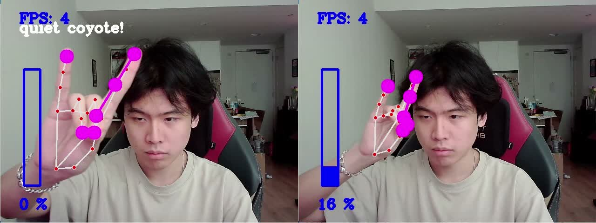

# A2 evidence — MediaPipe

I recorded this test on November 9, 2026. I tried hand tracking, pinch volume control, moving toward and away from the camera, Quiet Coyote, sideways rotation, and recovery.

**[Watch my full demo with audio (1:49)](hand-tracking.mp4)** · [My observations and interaction idea](../../README.md#a2-mediapipe)

| Time | What I tested |
|---|---|
| 0:05 | Open-hand tracking with visible finger dots. |
| 0:35 | Closing the pinch brings the display to 0%. |
| 0:45–0:49 | Moving closer while trying to keep the finger gap steady changes the display from 14% to 91%. I didn't measure the physical gap. |
| 1:00 | Quiet Coyote appears with 0% and silences the audio. |
| 1:04–1:05 | Rotating my hand makes the gesture label disappear; the display changes from 0% to 18% and audio resumes. Hand tracking continues. |
| 1:10 | Back in pinch control, I can adjust the volume again; the display shows 37%. |

*I can still see hand landmarks in both frames. Overlapping dots don't establish that the tracker merged the points; rotation changes their positions in the image and can hide fingers.*

## File details

- `hand-tracking.mp4` is an unchanged copy of my supplied `Recording 2026-11-09 132235.mp4`: 109.03 seconds, 1424 × 644, with audio.
- `quiet-coyote-rotation.jpg` combines crops of the camera window at exactly 60 and 65 seconds, left to right.
- The original and copied video have the same SHA-256: `30a9b15631f3ab0408b31fc8aa0a2652cab6851d2ceb3a195394f1f130163a6f`.
- The [course script](https://github.com/IRL-CT/Interactive-Lab-Hub/blob/9ef02d4ead28bafc0a803116a6a952f3908b7463/Lab%205/hand_pose.py) explains the pixel-distance controls. My exact Pi script and A2 package list aren't included here.

The files are available locally in this repository. Published video access still needs checking after upload.
