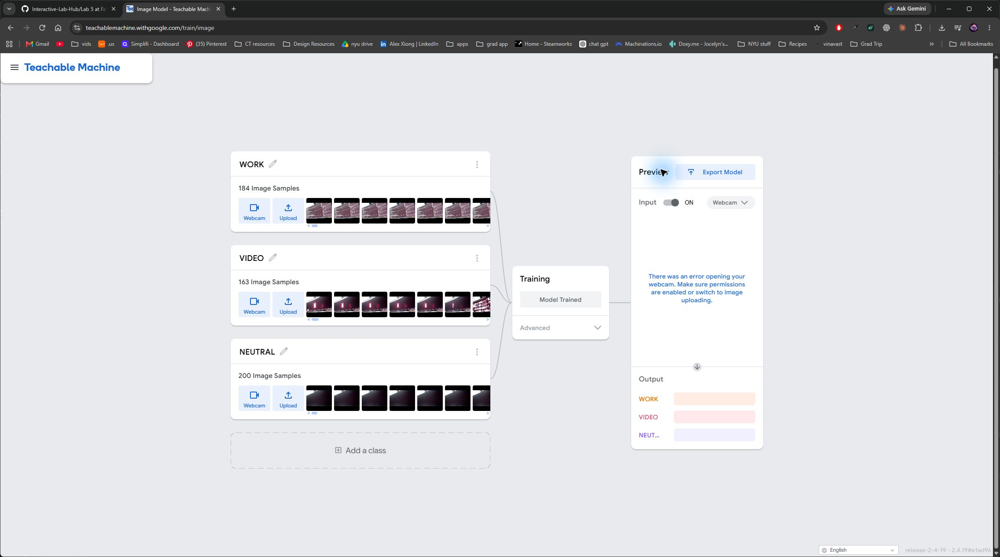
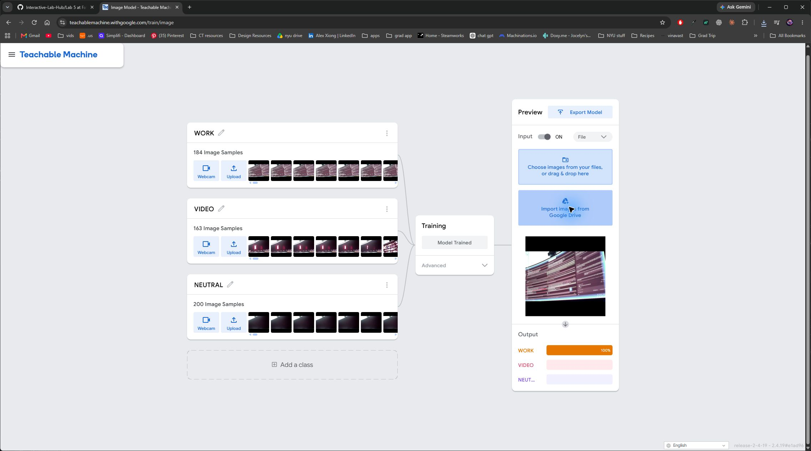
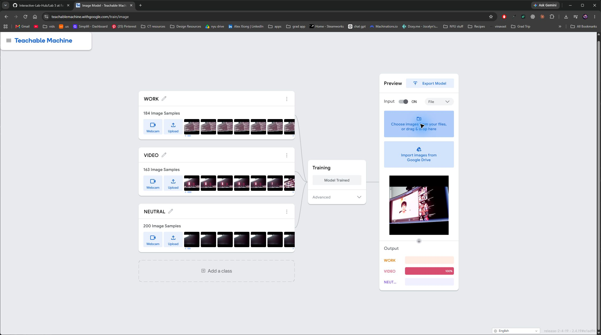
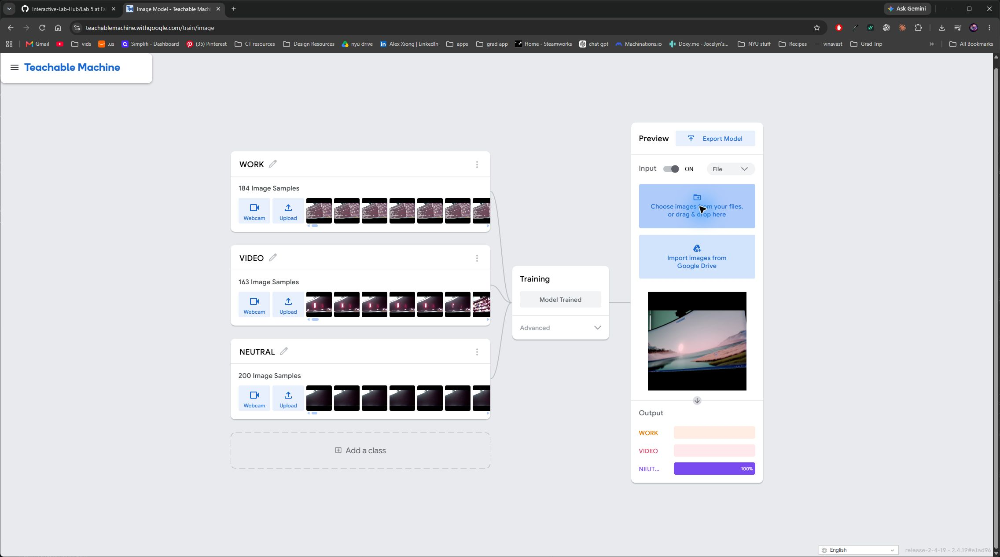
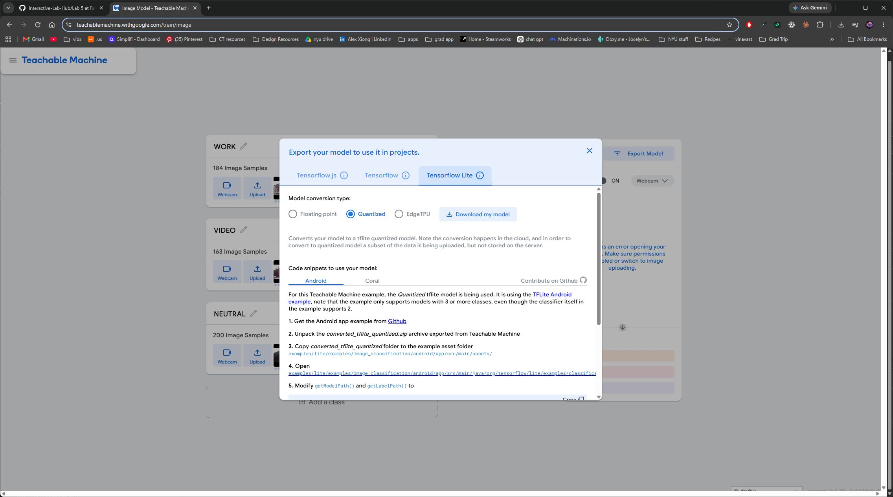

# A4 evidence

I ran the supplied `tml_example.py`, then trained and deployed my own classifier
following the [Lab 5 Teachable Machines exercise](https://github.com/IRL-CT/Interactive-Lab-Hub/blob/Fall2025/Lab%205/README.md#teachable-machines).

My first model used **156 WORK, 160 VIDEO, and 160 NEUTRAL** Kiyo images.
It misclassified the Pi view, so I collected a second dataset from the Pi webcam
at its shelf position: **184 WORK, 163 VIDEO, and 200 NEUTRAL** images.
NEUTRAL included 107 desktop and 93 blank-screen images.

[First model training screenshot](training-complete-camera-unavailable.png) |
[Initial Pi camera view](baseline-framing-check/latest-raw.png).

**Second model trained:**

**Preview:** I uploaded separately captured Pi images and checked all three classes.

| WORK | VIDEO | NEUTRAL |
|---|---|---|
|  |  |  |

**Export:** I selected TensorFlow Lite Quantized and transferred
[model.tflite](../../models/a4-pi-v2/model.tflite) and
[labels.txt](../../models/a4-pi-v2/labels.txt) to the Pi.

**Pi demonstration:** [Three-minute camera video](manual-20261110-163239/camera-review.mp4) |
[Prediction log](manual-20261110-163239/predictions.csv) |
[Results](manual-20261110-163239/README.md).

The classifier idea and comparison with OpenCV and MediaPipe are in the
[main A4 write-up](../../README.md#a4-teachable-machine).
