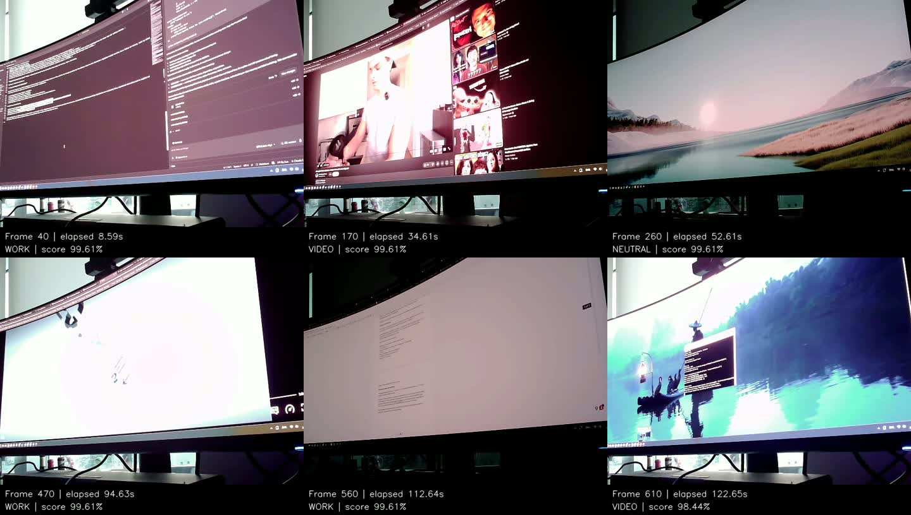

# A4 Pi demonstration - November 10, 2026

I recorded the Pi webcam while switching between my editor, a white work
document, video playback, and desktop scenes.

[Full video (2:59)](camera-review.mp4) | [Timestamped predictions](predictions.csv).

| Actual scene | Correct / labeled frames | Correct percentage |
|---|---:|---:|
| WORK | 472 / 474 | 99.6% |
| VIDEO | 333 / 362 | 92.0% |
| NEUTRAL | 21 / 36 | 58.3% |
| Total | 826 / 872 | 94.7% |

Bright fullscreen video sometimes became WORK (around 1:15 and 1:34).
The blue wallpaper with a small terminal became VIDEO (around 2:02 and 2:20).
The original wallpaper and white work document were recognized correctly.

The video and log contain 897 matching frames. **25 ambiguous transition frames
were excluded** from scoring. Scene labels came from one-second visual samples
and frame-by-frame review around identified boundaries; all scored errors were
checked visually. I confirmed the white document as WORK and wallpaper with a
small terminal as NEUTRAL. These results describe one short recording with
correlated frames, including only 36 labeled NEUTRAL frames.

[Reviewed intervals](annotations.csv) | [Per-frame results](scored-predictions.csv) |
[Calculation details](summary.json) | [Recording details](receipt.json).
