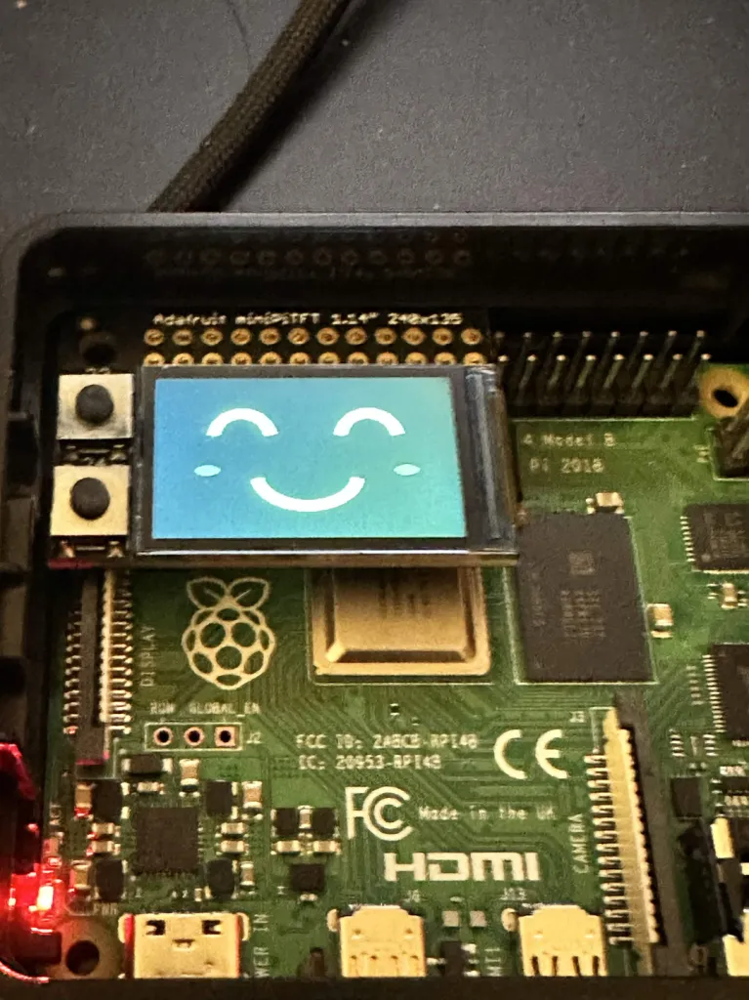
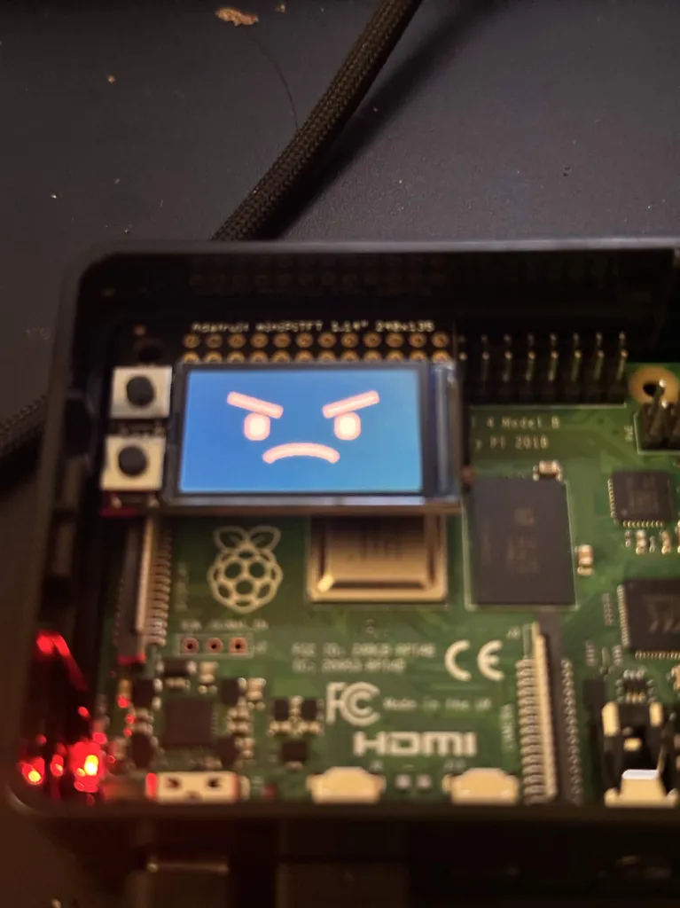
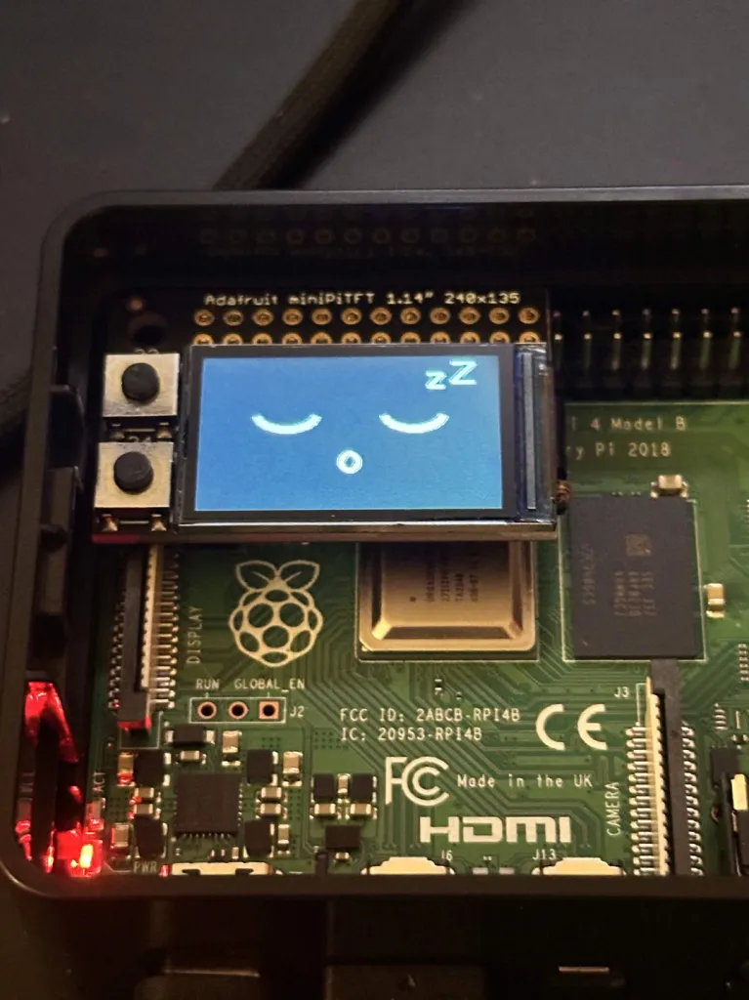

# Part B experiments

I tested editor, video, and desktop scenes through the Pi webcam, with sound
through the Leviathan V2 and faces on the mini PiTFT.

| Experiment | Trigger / cooldown | Evidence | Logged result |
|---|---|---|---|
| Triple beeps | 5 s / 0 s | [Phone video with audio, 0:59](beep-demo.mp4) | 11 starts, 10 completions; I stopped during the final clip. |
| Spoken clips | 15 s / 15 s | [Phone video with audio, 1:22](voice-demo.mp4) | Clips 01, 02, and 03 completed in order. |
| Voice + miniTFT | 15 s / 15 s | [Phone video with audio, 1:03](display-demo.mp4) | Happy, angry, and asleep states; clips 01 and 02 completed. |

I reported that the beep worked perfectly, and I preferred the spoken clips.
The voice reminders started at **25.65, 40.86, and 56.07 seconds** on the Pi's
capture clock. The phone recordings use separate clocks.

All three run logs meet their configured VIDEO-score, persistence, cooldown, and
non-overlap conditions. This verifies controller behavior against its predictions,
not classifier accuracy. All three tests were stopped manually after the demonstration.
The modes differed in timing as well as audio.

- [Beep predictions](beep-run/predictions.csv), [actions](beep-run/events.jsonl), [settings](beep-run/metadata.json).
- [Voice predictions](voice-run/predictions.csv), [actions](voice-run/events.jsonl), [settings](voice-run/metadata.json).
- [Display predictions](display-run/predictions.csv), [actions](display-run/events.jsonl), [settings](display-run/metadata.json).
- [Run checks and source hashes](run-summary.json).
- Recording provenance: [beep](beep-receipt.json), [voice](voice-receipt.json), [display](display-receipt.json).

The beep camera MP4 contains one final frame without a CSV row at manual stop;
only the 306 matched frames are logged. Its last audio start has no completion
before stopping. The voice recording has 393 matched frames and all three
completion events. Original logs are preserved. The recorder now finishes its
current frame/log pair before responding to Ctrl+C.

Experiment 3 saved **315 matched frames**. On the Pi capture clock, the display
first changed to happy at 1.66 s, angry at 10.10 s, and asleep at 49.72 s.
Reminders started at 25.08 s and 40.29 s. Brief uncertain/other predictions
occurred during scene changes. The phone video shows the physical angry face
around 0:25-0:26; the supplied photographs show all three faces.

| WORK: happy | VIDEO: angry | NEUTRAL: asleep |
|---|---|---|
|  |  |  |

[Setup and launch commands](../../docs/part-b-display.md).
