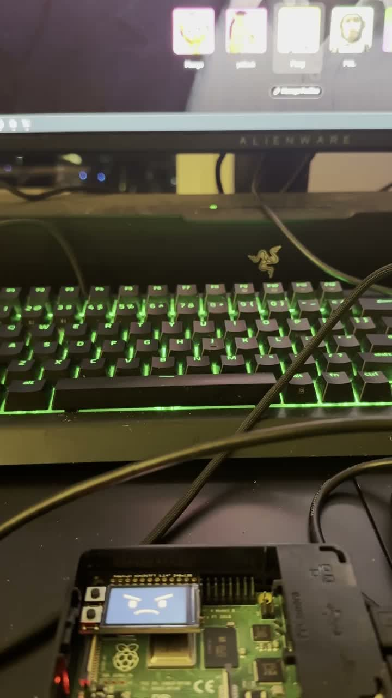
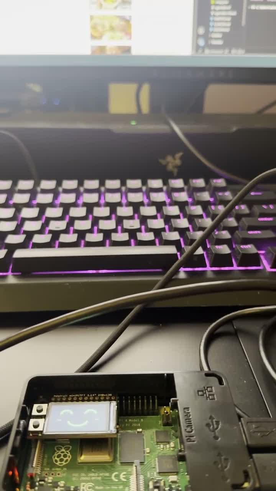
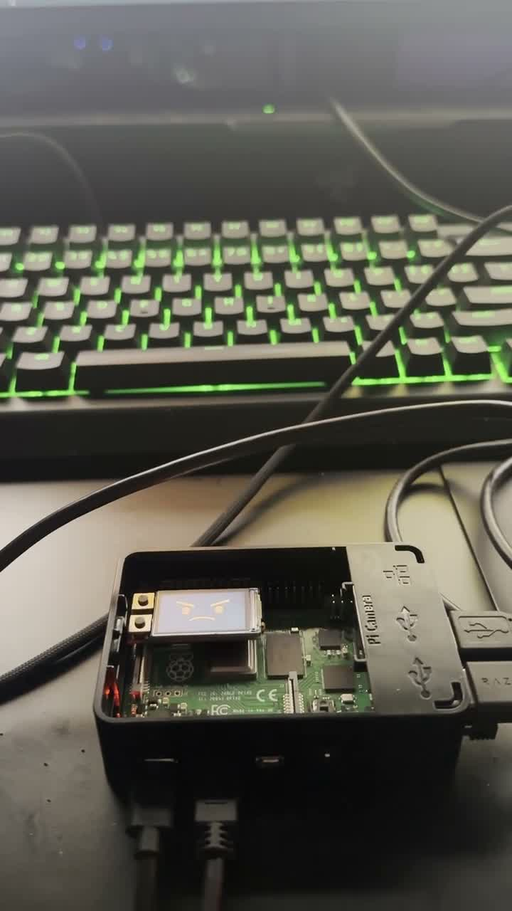
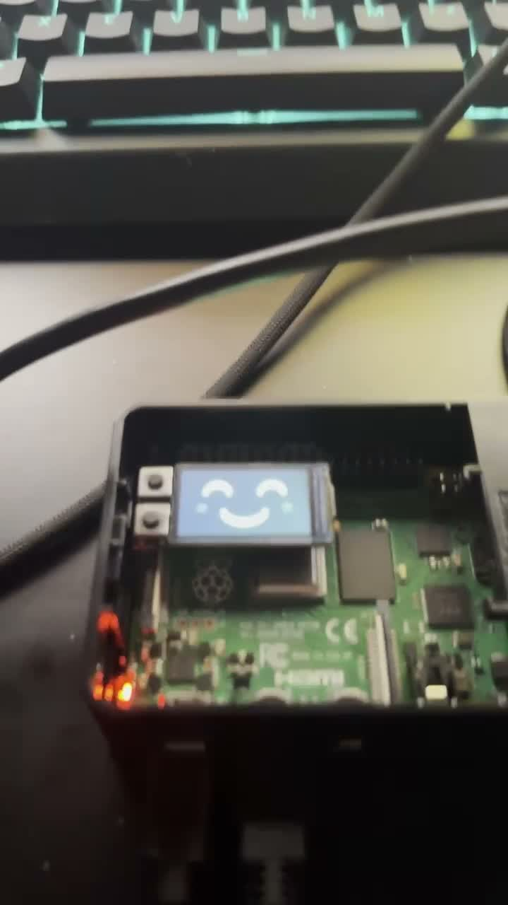
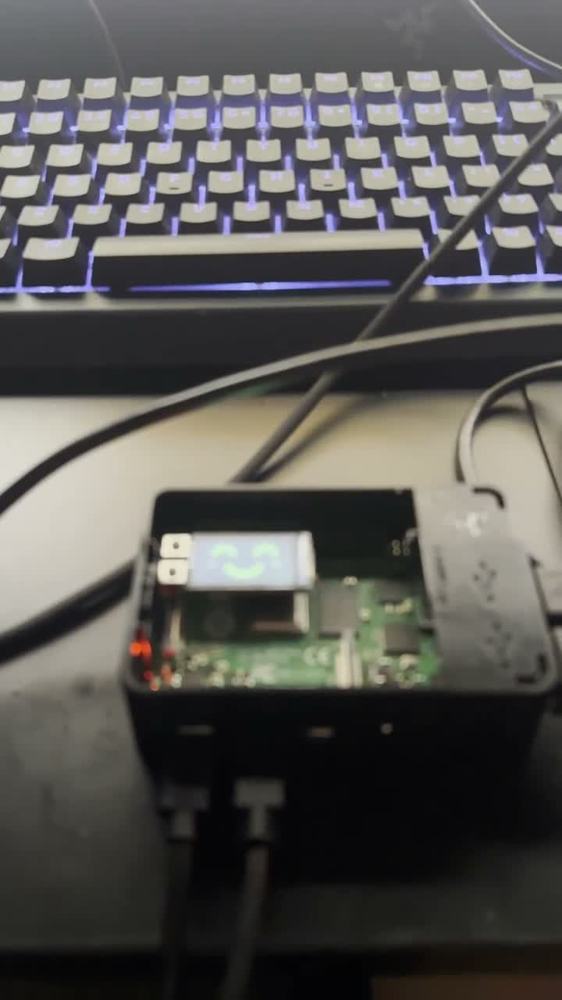

# Part D: characterize Shelf Watcher

I recorded a normal walkthrough and a second test with the room lights off. Both videos retain the full original picture, timing, and audio, including my narration. The seven characterization answers are in [Part D of the main README](../../README.md#part-d--reflect-characterize-the-system).

| Recording | Duration | Source |
|---|---|---|
| [Normal walkthrough](normal-walkthrough.mp4) | 2:42.277 | `IMG_8370.mov` |
| [No room lighting](no-room-lighting.mp4) | 0:27.793 | `IMG_8371.mov` |

## Normal walkthrough

Times below are approximate positions in the phone recording, not the Pi capture clock. Narration summaries are paraphrases, not verbatim transcripts.

| Time | My narration and the visible demonstration |
|---|---|
| 0:04–0:21 | I introduce the Pi and camera looking at the editor, describe the happy face, and switch to video. The display responds to the changed screen. |
| 0:22–0:43 | I show ElevenLabs, Google Docs, and the editor as work examples and describe their WORK recognition. |
| 0:44–1:31 | I switch through Netflix, Disney+, and HBO Max and describe the angry response. At 1:00, a Netflix profile-selection page is visible above the angry face: VIDEO can mean a site's appearance even without active playback. |
| 1:32–1:41 | I describe Prime Video as briefly confusing the classifier before it recognizes VIDEO. My explanation about the titles is an interpretation, not a measured cause. |
| 1:42–2:07 | I switch to Bilibili and describe the angry response there too. |
| 2:10–2:42 | I explain that an editor in front of or beside video can hide the video from recognition. I arrange Bilibili and an editor together and say the system believes I am working. The face is visibly happy at 2:38. This demonstrates a false WORK result for that mixed layout, not a universal result for every split-screen arrangement. |

| Streaming-site page: 1:00 | Split-screen failure: 2:38 |
|---|---|
|  |  |

## No room lighting

At 0:01–0:14, I explain that the room light is off and discuss the changed lighting. At 0:14–0:27, I describe the classifications changing while the screen remains on Bilibili. The phone view shows changing facial states, including angry at 0:14 and happy at 0:16 and 0:26, with puzzled states elsewhere. The same platform remains in use, but its playing video is not a static image.

| 0:14: angry / VIDEO | 0:16: happy / WORK | 0:26: happy / WORK |
|---|---|---|
|  |  |  |

The lighting condition is identified by my narration and supplied recording label. The phone's exposed image is not a measurement of the Pi webcam's input or room illumination. This clip demonstrates instability in the reported lights-off condition; it does not prove random classification or isolate exposure, resolution, and training coverage as causes. No lights-on recovery is shown.

## Evidence scope and review

- These recordings support the normal operation, mixed-layout failure, and lighting-related instability described in Part D. The feeling/participant observations come from the author's existing Part C reflection, not new participant interviews in these videos.
- The 15-second trigger, 15-second cooldown, and 85% threshold are documented in [Part B](../b1/README.md) and the implementation. No matching Pi prediction/event logs were supplied with these two phone recordings, so they are not used to calculate accuracy, exact reaction latency, or reminder counts.
- Review used local speech transcription with `faster-whisper` / `base.en`, checked against timestamped video frames. Machine transcription confused some proper names, so the guide paraphrases narration and uses the visible/contextual platform names. Raw automated transcripts and working contact sheets remain in ignored `evidence/private/d1-review/`.
- The originals remain in Downloads. FFmpeg copied their H.264 video and AAC audio streams into MP4 containers without cutting, speeding up, or re-encoding them. Both are 720 × 1280 with stereo audio. Selected JPGs are extracted frames, not generated illustrations.
- [File receipt](receipt.json) records source and deliverable hashes, duration, and stream verification. Remote publication and grader access have not been tested.
