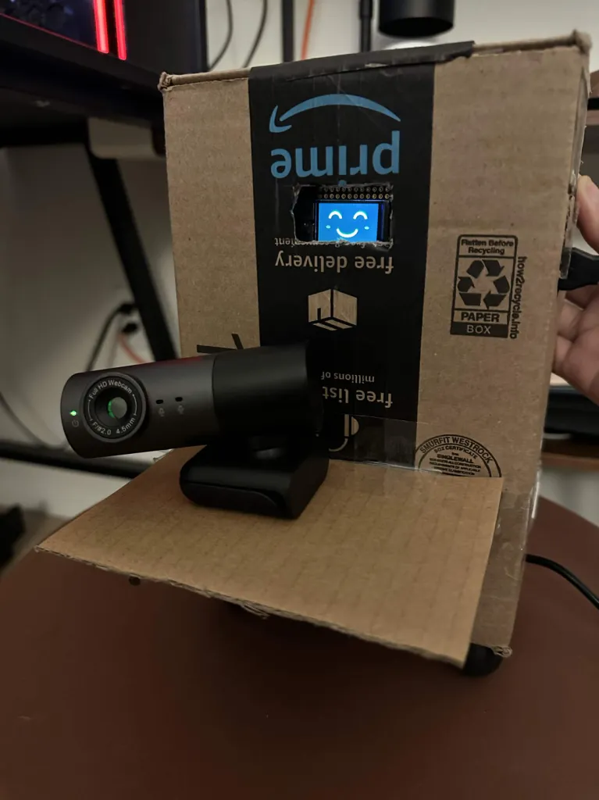
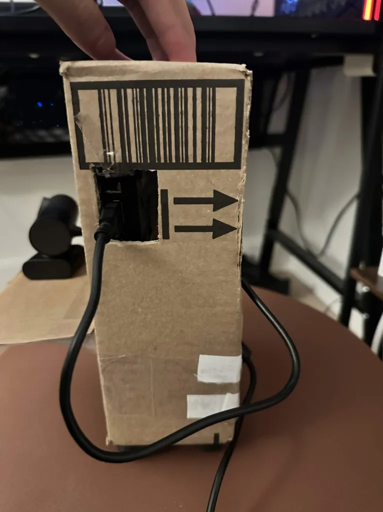
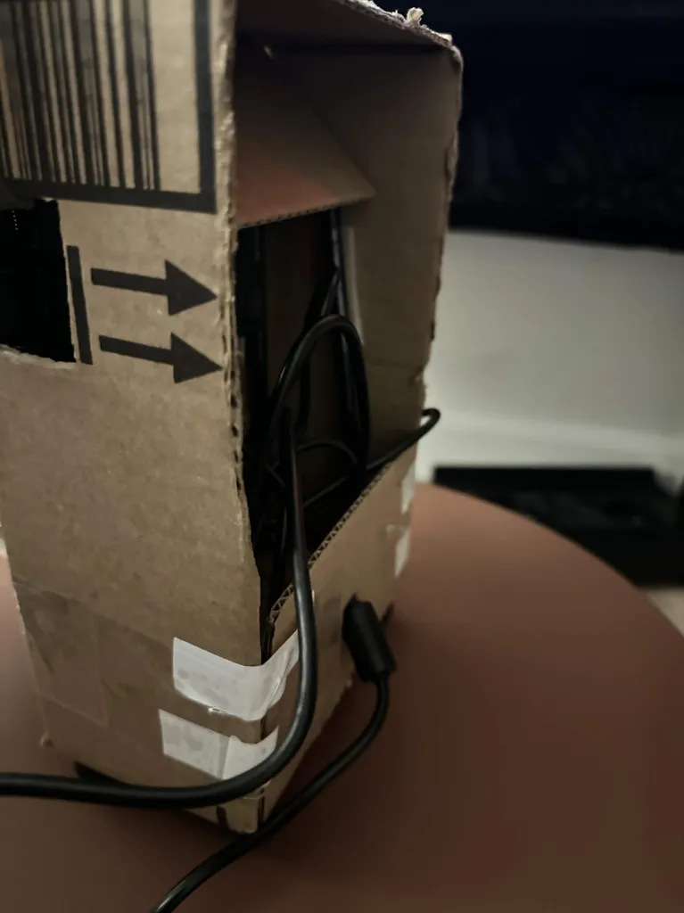

# Part 2: finished companion

**[Finished-system demonstration (1:28, with original sound)](finished-companion.mp4)**

The final build has a cardboard enclosure with the miniTFT expression display
attached to its front and the webcam below it. In the earlier trials, participants
mostly noticed the audio before the expression. I attached the face to the body
to make the device feel more like a companion. This is the design rationale,
not a measured improvement in attention or anthropomorphism.

## Video guide

Approximate times refer to the phone recording, not the Pi capture clock.

| Phone time | Demonstration |
|---|---|
| 0:00–0:20 | Work screen and finished companion beside the monitor; close views of the attached display. |
| 0:20–1:03 | Switch to video content. Spoken reminders are captured during this portion, and the camera also shows the companion. |
| 1:03–1:28 | Return to the work screen, with additional views of the enclosure and expression display. |

## Finished-build photographs

| Front: attached expression and webcam | Side: cable opening | Rear/side: interior and cables |
|---|---|---|
|  |  |  |

These three finished-build photos are included as WebP images. The front photo shows the happy expression clearly;
the other views document the enclosure and cable openings. The
[in-use frame at 1:10](enclosure-70s.jpg) also shows its position beside the monitor.

## Settings and log scope

The final run's [metadata](final-run/metadata.json) confirms a **10-second
sustained VIDEO trigger, 7-second cooldown, and 85% threshold**, with voice and
miniPiTFT output enabled. [Launch instructions](../../docs/part2-run.md)
reproduce the recorded configuration.

The final run is saved at
`/home/ne8ula/a4-shelf-watcher/runs/part-b/20261110-201915-491650-voice`.
The copied [predictions](final-run/predictions.csv), [events](final-run/events.jsonl),
and [metadata](final-run/metadata.json) are preserved unchanged. The run began
capturing at **8:19:26 p.m. EST on November 10, 2026** and was stopped manually
after **113.69 seconds**, with **568 logged frames**. It was configured for up to
300 seconds; it did not run for that full duration.

| Reminder | Clip | Start (Pi seconds) | Completion (Pi seconds) |
|---|---|---|---|
| 1 | 01 | 20.68 | 23.84 |
| 2 | 02 | 27.88 | 30.44 |
| 3 | 03 | 35.09 | 37.65 |
| 4 | 01 | 42.29 | 45.45 |
| 5 | 02 | 49.49 | 52.05 |

The first trigger row records **10.005 seconds** of sustained qualifying VIDEO.
The four subsequent start intervals are **7.203–7.205 seconds**. All five
reminders completed in order without overlapping, and every triggering frame
meets the configured confidence and persistence conditions.

The display log changes to happy at 0.20 s, angry at 10.71 s, happy at 49.72 s,
asleep at 57.93 s, and happy again at 67.53 s, with uncertain states at startup
and some transitions. After the return to WORK at 49.72 s, no new reminders
start; the clip already playing finishes at 52.05 s. These events record software
display writes; the phone video and photos show the physical display.

[Run checks and log hashes](run-summary.json) confirm the frame count, contiguous
frame IDs, increasing capture times, recomputed VIDEO streak durations, trigger
conditions, cooldown, clip order, and non-overlap. The run's model and audio
hashes match the local assets. The runner did not record deployed source hashes.
These checks validate controller behavior against its predictions, not classifier
accuracy. The phone recording is 88.26 seconds and has a separate clock; the
event times above are not phone-video timestamps, and no exact synchronization
is claimed. The earlier [Part B logs](../b1/README.md) remain separate evidence
for the previous 15-second trigger / 15-second cooldown configuration.

The phone recording demonstrates the finished physical system in use. No new
participant evaluation, classification-accuracy measurement, or tutorial
override is claimed. Earlier split-screen and lighting limitations remain
documented in [Part D](../d1/README.md).

## File verification

- Original recording: `IMG_8373.mov`.
- The deliverable copies the original H.264 video and AAC stereo audio into an
  MP4 container with faststart. No cuts, speed changes, or re-encoding.
- [Receipt](receipt.json): file hashes, stream checks, duration, and current local
  implementation hashes.
- [Photo receipt](photos-receipt.json): supplied source URLs, local filenames,
  dimensions, and hashes. The downloaded WebP versions are preserved without editing.
- Relative video and image links are provided for repository viewing/download.
  Remote publication and grader permissions have not been verified.
